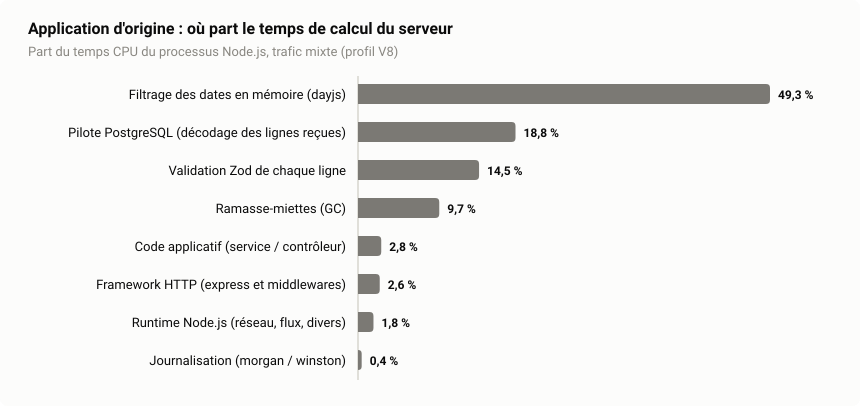
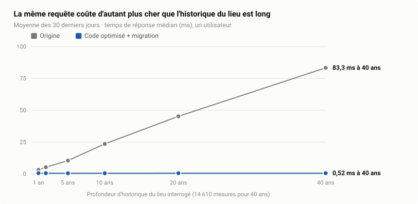
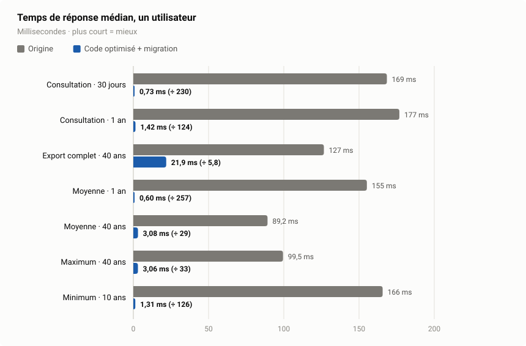
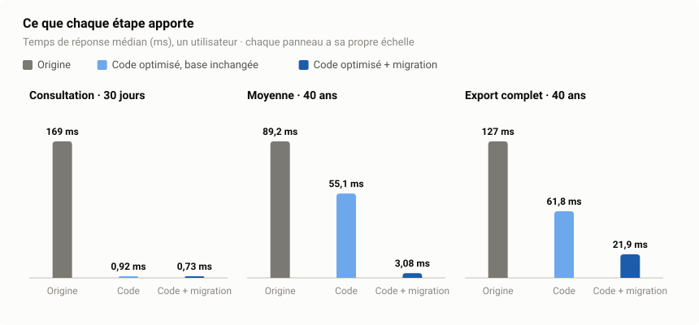
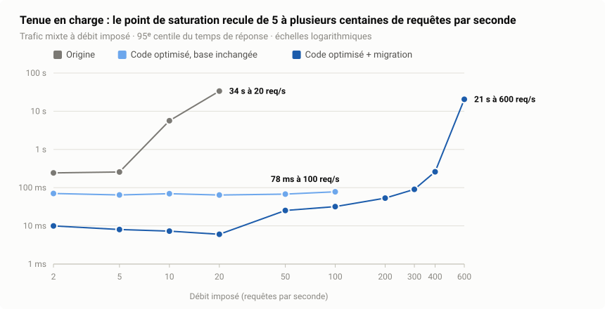

# WeatherTrack Pro — Rapport de performance

| | |
|---|---|
| **Projet** | Mini-projet 5PERF — audit et optimisation de WeatherTrack Pro |
| **Auteur** | Rayene BEN TORKIA |
| **Date** | 16 novembre 2026 |
| **Documents liés** | [Modifications du code](02-modifications-du-code.md) · [Recommandations](03-recommandations.md) · [Mesures brutes](benchmarks/README.md) |

## 1. Synthèse

**Le constat.** WeatherTrack Pro ralentit parce que chaque requête, quelle que soit la période
demandée, fait venir de la base **tout l'historique du lieu**, le décode, le revalide ligne par ligne,
puis le filtre en mémoire sur l'unique fil d'exécution du serveur. Le coût d'une requête dépend donc
du volume stocké et non de la réponse : mesuré sur une base de 14,6 millions de mesures (1 006 lieux,
40 ans), il augmente de 2 ms par année d'historique. L'application ralentit mécaniquement chaque jour.

**L'état initial.** Renvoyer 30 mesures prend 169 ms. Le service plafonne à 8 requêtes par seconde et
s'effondre dès 10 (5,6 secondes d'attente au 95ᵉ centile).

**Ce qui a été fait**, par ordre d'impact mesuré :

1. **le code** — le filtrage par période et les calculs (moyenne, minimum, maximum) sont confiés à
   PostgreSQL ; la validation ligne par ligne disparaît ;
2. **une migration** — un index couvrant regroupe les mesures de chaque lieu ; elle s'applique en
   ligne, en une vingtaine de secondes, sans interruption de service ;
3. **des réglages**, chacun retenu sur mesure — requêtes préparées, pagination, compression,
   exécution du code compilé.

**Le résultat**, même machine, mêmes données, mêmes requêtes :

| Indicateur | Avant | Après | Gain |
|:---|---:|---:|---:|
| Consulter un mois de mesures (médiane) | 169 ms | 0,73 ms | × 230 |
| Moyenne sur un an (médiane) | 155 ms | 0,60 ms | × 257 |
| Moyenne sur 40 ans (médiane) | 89 ms | 3,1 ms | × 29 |
| Exporter 40 ans, soit 14 610 mesures (médiane) | 127 ms | 22 ms | × 5,8 |
| Débit en trafic mixte, 20 utilisateurs | 8,5 req/s | 532 req/s | × 63 |
| Temps de réponse au 95ᵉ centile, même tir | 2 517 ms | 86 ms | ÷ 29 |
| Débit soutenu sans file d'attente | 5 req/s | 300 req/s | × 60 |
| Processeur consommé par requête, application et base | 187 ms | 2,8 ms | ÷ 66 |
| Même requête sur un lieu de 1 an, puis de 40 ans | 3,1 ms, puis 83 ms | 0,56 ms, puis 0,52 ms | Ne dépend plus du volume |

**La garantie.** Le contrat de l'API est inchangé : 1 104 requêtes ont été envoyées à l'application
d'origine et à la version optimisée, sans aucun écart inattendu ; la comparaison a été rejouée sous
quatre fuseaux horaires ; 47 tests automatisés figent ce comportement. Le seul changement voulu est la
correction d'une erreur 500 sur `/max` et `/min`.

**Ce qui reste.** L'export complet reste la requête la plus lourde, par nature. Quelques ambiguïtés
du contrat de l'API, l'absence d'indicateurs en production et un socle technique à mettre à jour sont
traités dans le [document de recommandations](03-recommandations.md), avec les stratégies de plus
long terme.

## 2. Contexte, périmètre et démarche

**Le besoin.** WeatherTrack Pro restitue l'historique météorologique de nombreux lieux et en calcule
des analyses (moyenne, minimum, maximum de température). À mesure que l'historique et le nombre de
lieux ont grandi, l'API de consultation est devenue lente, les analyses aussi, et les clients s'en
plaignent au point de résilier.

**Le périmètre.** L'audit porte sur le backend fourni : une API Node.js 20 (Express, TypeScript)
adossée à PostgreSQL 16, soit 335 lignes de code réparties en neuf fichiers. Nous n'avons accès ni
aux données réelles ni à l'environnement de production.

**La démarche.** Quatre temps, dans cet ordre :

1. **Mesurer.** Construire un jeu de données de taille réaliste et un banc de mesure rejouable, puis
   chiffrer l'état initial sur le code fourni, sans le modifier.
2. **Diagnostiquer.** Profiler le serveur, lire les plans d'exécution SQL, relire le code, et classer
   les causes par coût mesuré.
3. **Corriger par ordre d'impact.** Une étape à la fois, en re-mesurant après chacune, et en
   s'arrêtant quand le gain ne justifie plus le risque.
4. **Vérifier.** Prouver que les réponses de l'API sont restées les mêmes, par des tests automatisés
   et par comparaison directe avec l'application d'origine.

## 3. Méthode de mesure

### 3.1 Environnement

| Élément | Valeur |
|---|---|
| Machine | Machine virtuelle, 4 cœurs Intel Xeon à 2,1 GHz, 15,7 Go de mémoire, Ubuntu 24.04 |
| Node.js | 20.10.0 (version imposée par `.nvmrc`) |
| PostgreSQL | 16.15, **configuration par défaut** (`shared_buffers` = 128 Mo), comme l'image Docker du readme. Seule l'extension `pg_stat_statements` a été activée, pour l'audit, dans les trois états |
| Topologie | Application, base de données et injecteur de charge sur la même machine |

L'application, la base et l'injecteur se partagent les quatre cœurs : les valeurs absolues ne
prédisent pas celles d'une production, mais les trois états comparés ont été mesurés dans des
conditions strictement identiques. Ce sont les rapports entre eux qui font foi.

### 3.2 Jeu de données

Faute de données réelles, le script `bench/seed.mjs` génère une base déterministe dont la forme
reproduit ce que produit le flux d'ingestion de l'application :

- **1 000 lieux**, chacun avec **40 ans** d'historique quotidien (1984 à 2023), soit 14 610 mesures
  par lieu ;
- **6 stations supplémentaires** dont l'historique va de 1 à 40 ans, pour étudier l'effet du volume ;
- au total **14 638 488 mesures** : une table de 838 Mo et un index de clé primaire de 998 Mo ;
- des insertions **dans l'ordre chronologique** (toutes les stations pour un jour, puis le jour
  suivant), comme le font les robots d'ingestion. Ce point compte : il détermine la façon dont les
  mesures d'un lieu sont réparties sur le disque (voir le problème P6).

Les hypothèses de volume sont les nôtres. La section 7.6 montre comment les résultats évoluent quand
le volume par lieu varie.

### 3.3 Scénarios

| Scénario | Requête | Lignes renvoyées |
|---|---|---:|
| Consultation, 30 jours | `GET /weather/data/:lieu?from=…&to=…` sur une fenêtre de 30 jours tirée au hasard | 30 |
| Consultation, 1 an | Même route, fenêtre de 365 jours | 365 |
| Export complet | `GET /weather/data/:lieu` sans période | 14 610 |
| Moyenne, 1 an | `GET /weather/avg/:lieu?from=…&to=…` | 1 |
| Moyenne, 40 ans | `GET /weather/avg/:lieu` | 1 |
| Maximum, 40 ans | `GET /weather/max/:lieu` | 1 |
| Minimum, 10 ans | `GET /weather/min/:lieu?from=…&to=…` | 1 |
| Trafic mixte | 35 % consultation 30 jours, 15 % consultation 1 an, 5 % export complet, 20 % moyenne 1 an, 5 % moyenne 40 ans, 10 % maximum 40 ans, 10 % minimum 10 ans | — |
| Écriture | `POST /weather/data`, une mesure inédite par requête | — |

Lieux et fenêtres sont tirés par un générateur pseudo-aléatoire à graine fixe : chaque état reçoit
exactement la même suite de requêtes. La composition du trafic mixte est une hypothèse de notre part.

### 3.4 Indicateurs et outils

| Indicateur | Outil |
|---|---|
| Temps de réponse (médiane, 95ᵉ et 99ᵉ centiles), débit | Injecteur `bench/lib/load.mjs`, mesure à la microseconde. Deux modes : *boucle fermée* (N utilisateurs enchaînent les requêtes) et *boucle ouverte* (débit imposé, temps compté depuis l'instant d'envoi prévu, pour ne pas masquer les files d'attente) |
| Temps CPU par requête, côté Node.js et côté PostgreSQL | Lecture de `/proc` avant et après chaque tir (`bench/lib/procstat.mjs`) |
| Retard de la boucle d'événements, ramasse-miettes, mémoire | Sonde `bench/probe.mjs`, préchargée à l'identique dans les trois états |
| Répartition du temps CPU du serveur | Profil V8 (`node --cpu-prof`), résumé par `bench/profile-summary.mjs` |
| Coût des requêtes SQL | `EXPLAIN (ANALYZE, BUFFERS)` et extension `pg_stat_statements` |
| Égalité fonctionnelle des deux versions | Test différentiel `bench/compare.mjs` |

Le choix d'un injecteur écrit pour l'occasion tient à deux besoins que les outils courants ne
couvrent pas ensemble : des requêtes paramétrées identiques d'un tir à l'autre, et une résolution
inférieure à la milliseconde, indispensable une fois l'application optimisée.

### 3.5 Protocole

Trois états sont comparés : **l'origine**, **le code optimisé sur la base non migrée**, et **le code
optimisé sur la base migrée**. Pour chacun, la campagne (scriptée, exécutée d'une traite) :

1. recrée la base à partir du même instantané, force un `CHECKPOINT` et laisse la machine au repos ;
2. démarre l'application, l'échauffe 8 secondes en trafic mixte ;
3. enchaîne les tirs : un utilisateur (8 s par scénario après 2 s d'échauffement), vingt utilisateurs
   (15 s après 3 s), étude de volume (5 s), écriture (8 s), puis paliers à débit imposé (20 s chacun).

### 3.6 Limites de validité

- Les données sont synthétiques : leur forme est plausible, pas certifiée.
- Tout tourne sur une seule machine de quatre cœurs, sans latence réseau : l'effet de la compression
  et du cache HTTP sur de vrais clients n'est pas mesuré ici.
- PostgreSQL est en configuration par défaut ; un serveur réglé ferait mieux dans les trois états.
- Sur une machine virtuelle partagée, une même mesure varie de 20 à 40 % d'une exécution à l'autre
  pour l'application d'origine. Les écarts présentés ici sont d'un tout autre ordre.

## 4. État initial mesuré

### 4.1 Un utilisateur : 90 à 180 ms, quelle que soit la question posée

| Scénario | Lignes renvoyées | Médiane (ms) | p95 (ms) | CPU Node.js par requête (ms) | CPU PostgreSQL par requête (ms) |
|:---|---:|---:|---:|---:|---:|
| Consultation, fenêtre de 30 jours | 30 | 169 | 245 | 154 | 62,0 |
| Consultation, fenêtre d’un an | 365 | 177 | 255 | 173 | 61,9 |
| Export de tout l’historique (40 ans) | 14 610 | 127 | 155 | 109 | 65,7 |
| Moyenne sur un an | 1 | 155 | 206 | 142 | 58,0 |
| Moyenne sur tout l’historique | 1 | 89,2 | 106 | 72,8 | 59,4 |
| Maximum sur tout l’historique | 1 | 99,5 | 119 | 82,6 | 64,1 |
| Minimum sur dix ans | 1 | 166 | 218 | 154 | 59,3 |

Deux anomalies sautent aux yeux :

- **le temps de réponse ne dépend pas de la quantité demandée** : renvoyer 30 lignes coûte autant que
  d'en renvoyer 365, et *plus* que d'en renvoyer 14 610 ;
- **une requête avec période est plus lente qu'une requête sans période** (155 ms pour une moyenne
  sur un an, 89 ms pour la même moyenne sur 40 ans). Filtrer coûte plus cher que ne pas filtrer.

Ces deux observations désignent déjà la cause : le travail est proportionnel à l'historique complet
du lieu, et le filtrage s'y ajoute au lieu de le réduire.

### 4.2 Sous charge : un plafond à 6–8 requêtes par seconde

Avec vingt utilisateurs simultanés :

| Scénario | Débit (req/s) | Médiane (ms) | p95 (ms) | Retard max. de la boucle d’événements (ms) |
|:---|---:|---:|---:|---:|
| Consultation, fenêtre de 30 jours | 5,73 | 2 255 | 6 786 | 963 |
| Consultation, fenêtre d’un an | 6,00 | 2 324 | 5 421 | 1 317 |
| Export de tout l’historique (40 ans) | 11,1 | 1 455 | 3 032 | 796 |
| Moyenne sur un an | 5,87 | 2 463 | 3 525 | 1 445 |
| Moyenne sur tout l’historique | 17,3 | 1 062 | 1 367 | 508 |
| Maximum sur tout l’historique | 17,1 | 1 061 | 1 369 | 668 |
| Minimum sur dix ans | 6,27 | 2 559 | 3 554 | 1 441 |
| Trafic mixte | 8,47 | 2 057 | 2 517 | 1 065 |

Le débit ne dépasse pas ce qu'un seul utilisateur obtenait déjà : les vingt utilisateurs se
partagent la même file d'attente, et chacun attend en moyenne deux secondes.

À débit imposé, en trafic mixte, le point de rupture se situe entre 5 et 10 requêtes par seconde :

| Débit imposé (req/s) | Débit servi (req/s) | Médiane (ms) | p95 (ms) | Temps pour écouler la file après le tir (s) |
|---:|---:|---:|---:|---:|
| 2 | 2,00 | 157 | 244 | 0,00 |
| 5 | 5,00 | 173 | 257 | 0,00 |
| 10 | 8,25 | 2 725 | 5 646 | 3,86 |
| 20 | 7,15 | 26 629 | 33 732 | 33,9 |

À 10 requêtes par seconde, le serveur ne suit plus et le temps de réponse passe de 0,2 à 5,6
secondes au 95ᵉ centile. À 20, la file s'allonge sans fin : après 20 secondes de tir, la moitié des
requêtes attend déjà plus de 26 secondes. Pour un utilisateur, le service est en panne.

### 4.3 Où part le temps

**Côté serveur.** Le profil CPU du processus Node.js, en trafic mixte :



| Famille de code | Part du temps CPU |
|:---|---:|
| Filtrage des dates en mémoire (dayjs) | 49,3 % |
| Pilote PostgreSQL (décodage des lignes reçues) | 18,8 % |
| Validation Zod de chaque ligne | 14,5 % |
| Ramasse-miettes | 9,7 % |
| Code applicatif, framework HTTP, runtime, journalisation | 7,7 % |

Plus de 80 % du temps de calcul sert à décoder, valider et filtrer des lignes dont l'immense
majorité ne sera pas renvoyée. Le ramasse-miettes, sollicité par ces millions d'objets temporaires,
ajoute près de 10 %.

**Côté base.** L'application n'émet qu'une seule requête de lecture, toujours la même :

```
SELECT * FROM weather WHERE location = 'Station-0500'

Bitmap Heap Scan on weather  (actual time=6.265..27.370 rows=14610 loops=1)
  Heap Blocks: exact=14610
  Buffers: shared hit=13500 read=1243
  ->  Bitmap Index Scan on weather_pkey  (actual time=3.848..3.849 rows=14610 loops=1)
        Index Cond: ((location)::text = 'Station-0500'::text)
```

Quelle que soit la période demandée, PostgreSQL renvoie **14 610 lignes** et doit pour cela lire
**14 743 pages** de 8 ko — une par ligne (`Heap Blocks: exact=14610`). Pendant la campagne de mesure,
`pg_stat_statements` a compté 10 336 exécutions de cette requête, pour 253 secondes de travail cumulé.

**Par requête**, le coût se décompose ainsi (mesure à vingt utilisateurs, trafic mixte) : 128 ms de
CPU côté Node.js et 59 ms côté PostgreSQL. Un cœur de processeur ne peut donc servir que cinq à huit
requêtes par seconde — d'où le plafond observé, Node.js n'utilisant qu'un seul cœur.

### 4.4 Le temps de réponse suit le volume d'historique

La même question — la moyenne des 30 derniers jours — a été posée à des stations dont seul le volume
d'historique diffère :



| Historique du lieu | Mesures stockées | Temps de réponse médian (ms) |
|:---|---:|---:|
| 1 an | 365 | 3,12 |
| 2 ans | 730 | 5,23 |
| 5 ans | 1 826 | 10,5 |
| 10 ans | 3 652 | 23,6 |
| 20 ans | 7 305 | 45,2 |
| 40 ans | 14 610 | 83,3 |

La relation est linéaire : **environ 2 ms de plus par année d'historique**, pour une réponse qui
contient toujours 30 lignes. C'est l'explication du scénario décrit par WeatherTrack Pro : rien n'a
« cassé », l'application ralentit mécaniquement chaque jour, pour tous les lieux à la fois, et
continuerait de le faire.

### 4.5 Effets de bord

| Indicateur (trafic mixte, 20 utilisateurs) | Valeur |
|:---|---:|
| Retard maximal de la boucle d'événements | 1 065 ms |
| Temps passé en ramasse-miettes pendant les 15 s de tir | 1 867 ms |
| Pic de tas JavaScript | 238 Mo |
| Pic de mémoire résidente du processus | 453 Mo |
| Temps de démarrage de l'application | 2,15 s |
| Mémoire résidente au repos | 231 Mo |

Le retard de la boucle d'événements mesure le temps pendant lequel le serveur ne peut rien traiter
d'autre : une seconde entière, ici. Pendant qu'une requête filtre ses 14 610 lignes, toutes les
autres — y compris la plus simple — attendent.

## 5. Problèmes identifiés

### 5.1 Vue d'ensemble

| # | Problème | Gravité | Traitement |
|---|---|---|---|
| P1 | Tout l'historique du lieu est chargé à chaque lecture, puis filtré en mémoire | Critique | Corrigé (étape 1) |
| P2 | Le filtre en mémoire crée 3 à 10 objets dayjs par ligne | Critique | Corrigé (étape 1) |
| P3 | Moyenne, minimum et maximum sont calculés dans Node.js | Critique | Corrigé (étape 1) |
| P4 | Chaque ligne relue en base est revalidée par Zod | Majeur | Corrigé (étape 1) |
| P5 | Ces traitements bloquent la boucle d'événements | Critique | Disparaît avec P1 à P4 |
| P6 | Les mesures d'un lieu sont dispersées dans la table | Majeur | Corrigé (étape 2, migration) |
| P7 | L'index de la clé primaire est à moitié vide | Mineur | Corrigé (étape 2) |
| P8 | Chaque requête SQL est ré-analysée et re-planifiée | Mineur | Corrigé (étape 3) |
| P9 | Réponses volumineuses : ni borne, ni compression, ni cache | Majeur | Atténué (étape 3) ; suite en recommandation C3 |
| P10 | Le TypeScript est exécuté à la volée en production | Mineur | Corrigé (étape 3) |
| P11 | Pool de connexions sans réglage, arrêt brutal | Mineur | Corrigé (étape 3) |
| P12 | Code mort dangereux, dépendance inutilisée | Mineur | Corrigé |
| P13 | Défauts fonctionnels découverts pendant l'audit | Variable | Deux corrigés, trois en recommandation |
| P14 | Colonnes `DECIMAL` sans précision | Mineur | Évalué, écarté |
| P15 | Journal d'accès synchrone | Mineur | Recommandation B2 |
| P16 | Ni tests, ni indicateurs de performance | Structurel | Tests ajoutés ; observabilité en recommandation B2 |

### 5.2 Détail

#### P1 — Tout l'historique du lieu est chargé, puis filtré en mémoire

*Où :* `src/weather/repository.ts`, lignes 45-47 ; `src/weather/service.ts`, lignes 17-34 (code d'origine).

```ts
const query = `SELECT * FROM weather WHERE location = $1`;
```

La requête ne connaît pas la période demandée. Elle renvoie les 14 610 mesures du lieu ; le service
les filtre ensuite en JavaScript. Pour un mois de données, 99,8 % des lignes transférées sont jetées.

*Preuve :* 14 610 lignes par appel dans le plan d'exécution ; temps de réponse indépendant de la
taille de la fenêtre (section 4.1) et proportionnel à la profondeur d'historique (section 4.4).

#### P2 — Trois à dix objets dayjs par ligne

*Où :* `src/weather/service.ts`, lignes 23-34.

```ts
if (from && (dayjs(from).isAfter(datum.date) || dayjs(from).isSame(datum.date))) { return false; }
if (to && dayjs(to).isBefore(datum.date)) { return false; }
```

`dayjs(from)` et `dayjs(to)` sont reconstruits pour chaque ligne, et chaque comparaison crée à son
tour des objets intermédiaires. Nous avons compté : 3 objets pour une ligne antérieure à la période,
10 pour toutes les autres. Sur un historique de 40 ans, une seule requête crée de l'ordre de cent
mille objets, tous destinés au ramasse-miettes.

*Preuve :* 49,3 % du temps CPU du serveur (section 4.3). C'est pourquoi une requête filtrée est plus
lente qu'une requête non filtrée.

#### P3 — Les agrégats sont calculés dans Node.js

*Où :* `src/weather/service.ts`, lignes 37-74.

`getMean`, `getMax` et `getMin` appellent `getData` — donc chargent et filtrent tout l'historique —
puis parcourent le tableau avec `map` et `reduce`. Un calcul que PostgreSQL ferait sur place, en
renvoyant une seule valeur, coûte le transfert et le décodage de 14 610 lignes.

*Preuve :* les analyses sont aussi lentes que les consultations (section 4.1).

#### P4 — Chaque ligne relue en base est revalidée

*Où :* `src/weather/repository.ts`, lignes 55-57.

```ts
return result.rows.map((row) => WeatherDataSchema.parse(row)) as WeatherData[];
```

Le schéma Zod de l'API est appliqué à chaque ligne sortant de la base. Ces données ont déjà été
validées à l'ingestion ; la validation sert ici, indirectement, à convertir en nombres les colonnes
`DECIMAL` que le pilote renvoie sous forme de texte.

*Preuve :* 14,5 % du temps CPU du serveur.

#### P5 — La boucle d'événements est bloquée

Node.js traite toutes les requêtes sur un seul fil d'exécution. Les traitements P1 à P4 l'occupent
jusqu'à 200 ms d'affilée par requête : pendant ce temps aucune autre requête n'avance, pas même une
requête invalide qui ne demanderait qu'une réponse d'erreur. C'est ce mécanisme qui transforme un
temps de réponse « lent mais acceptable » pour un utilisateur seul en plusieurs secondes d'attente
dès qu'ils sont quelques-uns.

*Preuve :* retard de la boucle d'événements jusqu'à 1,4 seconde sous vingt utilisateurs
(section 4.2) ; débit identique avec un ou vingt utilisateurs.

#### P6 — Les mesures d'un lieu sont dispersées dans la table

*Où :* structure physique de la table `weather` ; schéma dans `src/weather/repository.ts`, lignes 16-22.

Les robots insèrent chaque jour une mesure par lieu : la table est donc rangée par date. Les 14 610
mesures d'un lieu se trouvent sur 14 610 pages différentes. Lire l'historique d'un lieu revient à
visiter 115 Mo de pages pour en extraire 400 ko de données. Avec les 128 Mo de cache de la
configuration par défaut, une seule requête renouvelle presque tout le cache de PostgreSQL.

*Preuve :* `Heap Blocks: exact=14610` dans le plan d'exécution ; 59 à 73 ms de CPU PostgreSQL par
requête. Ce problème est masqué par P1 à P4 à l'origine ; il devient le facteur limitant dès que le
code est corrigé (section 7.1).

#### P7 — L'index de la clé primaire est à moitié vide

L'index `(location, date)` pèse 998 Mo pour 14,6 millions d'entrées, plus que la table elle-même.
Les insertions arrivent toujours au milieu de l'index, à la fin de la plage de chaque lieu : les
pages se scindent en deux moitiés qui ne se remplissent plus. Reconstruit, le même index — avec
deux colonnes de plus — n'occupe que 690 Mo.

#### P8 — Chaque requête est ré-analysée et re-planifiée

Invisible à l'origine (une requête dure 60 ms), ce coût fixe devient la moitié du travail de la base
une fois les requêtes ramenées sous la milliseconde (section 7.3).

#### P9 — Des réponses volumineuses, sans borne, sans compression, sans cache

Un export complet pèse 1,4 Mo de JSON. L'API ne propose aucun moyen de le borner, ne le compresse
pas, et n'émet aucun en-tête permettant à un navigateur ou à un cache intermédiaire de réutiliser
une réponse.

#### P10 — Le TypeScript est exécuté à la volée

*Où :* `package.json`, script `start`.

`npm start` lance `ts-node` par un chargeur expérimental de Node.js : le compilateur TypeScript est
chargé dans le processus serveur, y compris en production. Le régime établi n'en souffre pas, mais
chaque démarrage prend 2,15 secondes et chaque instance occupe 231 Mo au repos, contre 0,31 seconde
et 65 Mo pour le même code compilé. Les dépendances de développement sont nécessaires à l'exécution.

#### P11 — Pool de connexions sans réglage, arrêt brutal

Le pool PostgreSQL est créé avec ses valeurs par défaut : aucun délai d'attente d'une connexion ni
de durée maximale de requête. En cas de saturation, les requêtes s'empilent sans limite. À l'arrêt,
`SIGINT` coupe les requêtes en cours et `SIGTERM` n'est pas géré.

#### P12 — Code mort dangereux

`getAllWeatherData()` exécute `SELECT * FROM weather` sans aucune condition. Elle n'est appelée nulle
part, mais un appel suffirait à charger 14,6 millions de lignes en mémoire. La dépendance `axios`
n'est jamais importée.

#### P13 — Défauts fonctionnels découverts pendant l'audit

| Défaut | Décision |
|---|---|
| `/max` et `/min` répondent 500 quand la période ne contient aucune mesure (`data[0]` sur un tableau vide) | **Corrigé** : `null`, comme `/avg` |
| L'ordre des mesures renvoyées n'est pas garanti (pas de `ORDER BY`) | **Corrigé** : tri par date |
| Une mesure `null` est acceptée, stockée `NULL`, puis restituée comme 0 | Conservé ; recommandation A1 |
| Un doublon (lieu, date) répond 500 | Conservé ; recommandation A2 |
| `from` exclu, `to` inclus ; jour local du serveur ; la validation ne convertit pas les paramètres, contrairement à ce qu'indiquent les types | Conservé et documenté ; recommandation A3 |

Les trois derniers touchent aux données ou au contrat de l'API : les modifier n'est pas une décision
d'optimisation.

#### P14 à P16

- **P14 — `DECIMAL` sans précision.** Le passage à un type flottant a été mesuré : 1,3 ms de gain sur
  la requête la plus lourde, aucun gain de stockage, pour une réécriture complète de la table. Écarté
  (détail dans les [recommandations](03-recommandations.md), A5).
- **P15 — Journal d'accès synchrone.** Négligeable à 8 requêtes par seconde, mesurable à plusieurs
  milliers (section 7.3). Non modifié.
- **P16 — Ni tests, ni indicateurs.** Jest est déclaré mais le projet ne contient aucun test ;
  l'application n'expose aucune métrique. Rien ne pouvait alerter avant les clients.

## 6. Impact sur l'expérience utilisateur et sur l'activité

**Pour l'utilisateur.**

- *Seul sur le service*, il attend 90 à 180 ms par appel : perceptible, pas bloquant. C'est
  probablement ce que voient les développeurs sur leur poste.
- *Dès que quelques utilisateurs sont actifs en même temps*, chacun attend derrière les autres : deux
  secondes en médiane et jusqu'à près de sept secondes à vingt utilisateurs (section 4.2). Un tableau
  de bord qui enchaîne plusieurs appels cumule ces attentes.
- *Au-delà de 5 à 8 requêtes par seconde*, les temps de réponse se comptent en dizaines de secondes :
  les navigateurs et les intégrations abandonnent. Le service est disponible en théorie, inutilisable
  en pratique.
- *Les analyses* — la valeur ajoutée du produit — ne sont pas plus rapides que la consultation brute,
  et deux d'entre elles répondent par une erreur sur une période vide.

**Pour l'activité.**

- **Fidélisation.** Le public visé (météorologues, agriculture, événementiel) consulte des séries
  longues, aux heures où les autres le font aussi. Ce sont précisément les situations les plus
  dégradées ; la hausse des résiliations est cohérente avec les mesures.
- **Plafond de croissance.** Une instance sature à 6–8 requêtes par seconde. Chaque nouveau client
  rapproche du point de rupture, et chaque année d'historique ajoutée l'abaisse (section 4.4) : le
  service ralentit même sans nouveau client.
- **Coût d'infrastructure.** Une requête consomme près de 190 ms de processeur (128 ms côté
  application, 59 ms côté base). Tenir 100 requêtes par seconde demanderait une vingtaine de cœurs,
  dont une part côté base de données, la plus difficile à faire grandir.
- **Risque opérationnel.** Sans délai de garde sur le pool ni borne sur les réponses, un pic de trafic
  ne se résorbe pas : la file observée à 20 requêtes par seconde met 34 secondes à s'écouler après
  l'arrêt du tir.

## 7. Optimisations réalisées et résultats

Les corrections ont été faites dans l'ordre de leur coût mesuré, et l'application re-mesurée après
chaque étape. Le détail du code est dans la [documentation des modifications](02-modifications-du-code.md) ;
cette section en donne les effets.

### 7.1 Étape 1 — Le filtrage et les calculs reviennent à la base

**Ce qui change.** La requête SQL reçoit la période demandée et PostgreSQL calcule lui-même moyenne,
minimum et maximum (P1, P3). Les bornes de dates sont converties une seule fois par requête au lieu
de 3 à 10 fois par ligne (P2). La validation Zod ligne par ligne disparaît : le pilote convertit
directement les valeurs (P4). Aucun changement dans la base.

**Ce que l'on mesure**, code optimisé sur la base **non migrée**, un utilisateur :

| Scénario | Origine (ms) | Code optimisé, base non migrée (ms) | Gain | CPU PostgreSQL par requête (ms) |
|:---|---:|---:|---:|---:|
| Consultation, fenêtre de 30 jours | 169 | 0,92 | × 184 | 0,21 |
| Consultation, fenêtre d’un an | 177 | 2,46 | × 72 | 1,29 |
| Export de tout l’historique (40 ans) | 127 | 61,8 | × 2,0 | 48,0 |
| Moyenne sur un an | 155 | 2,26 | × 69 | 1,36 |
| Moyenne sur tout l’historique | 89,2 | 55,1 | × 1,6 | 49,9 |
| Maximum sur tout l’historique | 99,5 | 53,8 | × 1,8 | 48,7 |
| Minimum sur dix ans | 166 | 13,9 | × 12 | 11,9 |

Les requêtes qui portent sur une fenêtre de temps sont réglées : elles ne lisent plus que ce
qu'elles renvoient. La boucle d'événements n'est plus bloquée (P5) et le débit en trafic mixte passe
de 8 à 230 requêtes par seconde.

Mais les analyses sur tout l'historique ne gagnent qu'un facteur 1,6, et l'export complet reste à
62 ms. Le serveur Node.js n'y est plus pour grand-chose (il consomme 1 à 3 ms par requête d'analyse) :
c'est PostgreSQL qui dépense désormais 50 ms de processeur à aller chercher, une page après l'autre,
les 14 610 mesures dispersées du lieu. Le problème P6, masqué jusque-là, devient le facteur limitant.

Les plans d'exécution le confirment (base non migrée) :

| Requête | Lignes lues | Pages lues | Parcours |
|:---|---:|---:|:---|
| Origine, toute requête | 14 610 | 14 743 | Table, via l'index |
| Optimisé, consultation de 30 jours | 30 | 34 | Index, puis une page de table par ligne |
| Optimisé, moyenne sur 40 ans | 14 610 | 14 743 | Table, via l'index |

La consultation d'un mois ne lit plus que 34 pages. La moyenne sur 40 ans, elle, lit toujours les
mêmes 14 743 pages qu'à l'origine : le filtre ne peut rien y faire, puisque toutes les lignes sont
demandées.

### 7.2 Étape 2 — Une migration regroupe les mesures de chaque lieu

**Ce qui change.** L'index de la clé primaire `(location, date)` est remplacé par un index
**couvrant**, qui contient aussi la température et l'humidité. Dans cet index, les mesures d'un lieu
sont contiguës et triées : PostgreSQL répond sans plus visiter la table (*index-only scan*).

```
SELECT avg(COALESCE(temperature, 0)) AS value FROM weather WHERE location = 'Station-0500' AND …

Aggregate  (actual time=3.628..3.628 rows=1 loops=1)
  Buffers: shared hit=96
  ->  Index Only Scan using weather_pkey on weather  (actual time=0.033..2.198 rows=14610 loops=1)
        Heap Fetches: 0
```

| Requête, base migrée | Lignes lues | Pages lues | Parcours |
|:---|---:|---:|:---|
| Consultation de 30 jours | 30 | 5 | Index seul |
| Moyenne sur 40 ans | 14 610 | 96 | Index seul |
| Export des 40 ans | 14 610 | 96 | Index seul |

Les 40 ans d'un lieu tiennent désormais sur **96 pages** contiguës au lieu de 14 743 pages
dispersées, et la table n'est plus visitée (`Heap Fetches: 0`).

**La migration elle-même** a été jouée sur la base complète :

| | |
|---|---|
| Durée | 16 secondes pendant la campagne officielle, 22 lors d'un premier essai, pour 14,6 millions de lignes |
| Disponibilité | Aucune interruption : construction `CONCURRENTLY`, puis bascule de la clé primaire en 0,7 s. Rejouée **sous trafic** (8 lecteurs, 2 robots d'écriture ; 28 secondes dans ces conditions) : 11 974 lectures et 4 903 écritures servies pendant le tir de 45 secondes qui l'englobait, aucun échec ; la requête la plus lente a attendu 1,4 s, à l'instant de la bascule |
| Espace disque | Index de 690 Mo, contre 998 Mo pour l'ancien (P7) : la base **rétrécit** de 308 Mo |
| Écritures | Débit d'ingestion inchangé (section 7.8) |
| Durabilité | Autovacuum de la table réglé pour que les lectures par index seul le restent quand la table grandit |

**Ce que l'on mesure**, code optimisé, avant puis après migration, un utilisateur :

| Scénario | Avant migration (ms) | Après migration (ms) | Gain de l’étape | CPU PostgreSQL par requête, avant → après (ms) |
|:---|---:|---:|---:|---:|
| Consultation, fenêtre de 30 jours | 0,92 | 0,73 | × 1,3 | 0,21 → 0,11 |
| Consultation, fenêtre d’un an | 2,46 | 1,42 | × 1,7 | 1,29 → 0,28 |
| Export de tout l’historique (40 ans) | 61,8 | 21,9 | × 2,8 | 48,0 → 6,50 |
| Moyenne sur un an | 2,26 | 0,60 | × 3,7 | 1,36 → 0,14 |
| Moyenne sur tout l’historique | 55,1 | 3,08 | × 18 | 49,9 → 2,47 |
| Maximum sur tout l’historique | 53,8 | 3,06 | × 18 | 48,7 → 2,39 |
| Minimum sur dix ans | 13,9 | 1,31 | × 11 | 11,9 → 0,66 |

### 7.3 Étape 3 — Des réglages complémentaires, chacun mesuré

Une fois les deux causes majeures levées, un nouveau profil a montré ce qui restait. Chaque réglage
ci-dessous a été retenu — ou écarté — sur la foi d'une mesure.

| Réglage | Ce que montre la mesure | Décision |
|:---|:---|:---|
| Requêtes préparées nommées (P8) | CPU PostgreSQL par requête : 0,30 ms → 0,18 ms pour une moyenne sur un an (− 41 %), 0,22 ms → 0,11 ms pour une consultation de 30 jours (− 51 %). Sans effet sur les analyses longues. | Retenu |
| Mémorisation de la conversion des dates | Export complet : 56 ms → 34 ms lors des essais de développement | Retenu |
| Pagination optionnelle, paramètre `limit` (P9) | Première page de 1 000 mesures : 2,4 ms et 94 ko, contre 24 ms et 1,38 Mo pour l'export complet | Retenu, sans effet si le paramètre est absent |
| Compression des réponses de plus de 4 ko (P9) | Export : 1,38 Mo → 119 ko pour 5 ms de plus. Consultation d'un an : 34 ko → 3,1 ko pour 6 % de débit en moins | Retenu, désactivable |
| En-tête `Cache-Control` de 60 secondes (P9) | Non mesurable sans cache intermédiaire | Retenu, réglable |
| Exécution du code compilé (P10) | Démarrage : 2,15 s → 0,31 s. Mémoire au repos : 231 Mo → 65 Mo. Débit inchangé | Retenu |
| Pool de connexions réglé, arrêt propre (P11) | Robustesse : pas de gain de débit attendu | Retenu |
| Suppression du journal d'accès (P15) | Débit à saturation : 2 725 → 3 704 req/s sur la moyenne sur un an. Le journal coûte de 23 à 28 % du CPU du serveur sur les requêtes courtes | **Écarté** : l'observabilité prime (recommandation B2) |
| Colonnes `DECIMAL` converties en `REAL` (P14) | Moyenne sur 40 ans : 3,8 ms → 2,5 ms côté base. Aucun gain de stockage | **Écarté** : réécriture de toute la table pour 1,3 ms |

Les mesures A/B de ce tableau ont été faites à vingt utilisateurs, machine au repos, en alternant deux
fois l'état final et chaque variante ; elles sont consignées dans `benchmarks/secondary-variants.txt`
et `benchmarks/secondary.txt`.

Ces réglages pèsent peu face aux deux premières étapes, et c'est voulu : le rapport de 1 à 100 était
dans le code et dans l'index. Le journal d'accès illustre la limite de l'exercice — à ce niveau de
débit, chaque gain supplémentaire se paie par une fonction utile.

### 7.4 État final comparé à l'état initial



| Scénario | Lignes renvoyées | Origine — médiane | p95 | Code optimisé seul — médiane | p95 | Code optimisé + migration — médiane | p95 | Gain (médiane) |
| :--- | ---: | ---: | ---: | ---: | ---: | ---: | ---: | ---: |
| Consultation, fenêtre de 30 jours | 30 | 169 | 245 | 0,92 | 1,36 | 0,73 | 1,12 | × 230 |
| Consultation, fenêtre d’un an | 365 | 177 | 255 | 2,46 | 3,14 | 1,42 | 2,17 | × 124 |
| Export de tout l’historique (40 ans) | 14 610 | 127 | 155 | 61,8 | 81,8 | 21,9 | 34,1 | × 5,8 |
| Moyenne sur un an | 1 | 155 | 206 | 2,26 | 2,80 | 0,60 | 0,98 | × 257 |
| Moyenne sur tout l’historique | 1 | 89,2 | 106 | 55,1 | 63,4 | 3,08 | 4,72 | × 29 |
| Maximum sur tout l’historique | 1 | 99,5 | 119 | 53,8 | 61,6 | 3,06 | 4,21 | × 33 |
| Minimum sur dix ans | 1 | 166 | 218 | 13,9 | 17,0 | 1,31 | 1,94 | × 126 |



Les temps de réponse sont divisés par 124 à 257 pour les requêtes sur une période, par une trentaine
pour les analyses sur tout l'historique, et par 5,8 pour l'export complet. Ce dernier reste la
requête la plus lourde : il renvoie réellement 14 610 lignes et 1,4 Mo de JSON, que rien ne peut
éviter de produire tant que le client les demande. La pagination ajoutée (section 7.3) et les
recommandations C3 traitent ce cas.

### 7.5 Tenue en charge

Vingt utilisateurs simultanés enchaînent les requêtes (débit en requêtes par seconde, temps en
millisecondes) :

| Scénario | Origine — débit | médiane | p95 | Code optimisé seul — débit | médiane | p95 | Code optimisé + migration — débit | médiane | p95 | Gain (débit) |
| :--- | ---: | ---: | ---: | ---: | ---: | ---: | ---: | ---: | ---: | ---: |
| Consultation, fenêtre de 30 jours | 5,73 | 2 255 | 6 786 | 2 191 | 8,39 | 14,8 | 2 616 | 7,30 | 11,3 | × 457 |
| Consultation, fenêtre d’un an | 6,00 | 2 324 | 5 421 | 786 | 24,0 | 39,4 | 998 | 19,5 | 29,3 | × 166 |
| Export de tout l’historique (40 ans) | 11,1 | 1 455 | 3 032 | 29,9 | 614 | 845 | 37,3 | 509 | 695 | × 3,4 |
| Moyenne sur un an | 5,87 | 2 463 | 3 525 | 1 569 | 12,4 | 19,2 | 3 083 | 5,96 | 10,3 | × 525 |
| Moyenne sur tout l’historique | 17,3 | 1 062 | 1 367 | 64,2 | 305 | 363 | 1 239 | 15,2 | 25,0 | × 71 |
| Maximum sur tout l’historique | 17,1 | 1 061 | 1 369 | 65,9 | 295 | 367 | 1 280 | 14,8 | 24,5 | × 75 |
| Minimum sur dix ans | 6,27 | 2 559 | 3 554 | 269 | 73,1 | 97,1 | 2 623 | 7,15 | 12,6 | × 418 |
| Trafic mixte | 8,47 | 2 057 | 2 517 | 230 | 65,1 | 215 | 532 | 34,2 | 86,0 | × 63 |

À débit imposé, en trafic mixte :



| Débit imposé (req/s) | Origine — servi | médiane (ms) | p95 (ms) | Code optimisé seul — servi | médiane (ms) | p95 (ms) | Code optimisé + migration — servi | médiane (ms) | p95 (ms) |
| ---: | ---: | ---: | ---: | ---: | ---: | ---: | ---: | ---: | ---: |
| 2 | 2,00 | 157 | 244 | 2,00 | 4,02 | 70,5 | 2,00 | 3,22 | 9,96 |
| 5 | 5,00 | 173 | 257 | 5,00 | 3,34 | 64,5 | 5,00 | 2,78 | 8,02 |
| 10 | 8,25 | 2 725 | 5 646 | 10,0 | 3,29 | 69,4 | 10,0 | 2,46 | 7,28 |
| 20 | 7,15 | 26 629 | 33 732 | 20,0 | 3,42 | 64,0 | 20,0 | 2,27 | 6,01 |
| 50 |  |  |  | 49,9 | 2,72 | 67,7 | 50,0 | 1,68 | 25,2 |
| 100 |  |  |  | 100 | 3,03 | 78,0 | 100 | 1,74 | 31,9 |
| 200 |  |  |  |  |  |  | 200 | 2,61 | 53,3 |
| 300 |  |  |  |  |  |  | 299 | 11,8 | 90,2 |
| 400 |  |  |  |  |  |  | 393 | 38,3 | 260 |
| 600 |  |  |  |  |  |  | 402 | 4 187 | 20 534 |

- **L'origine** décroche entre 5 et 10 requêtes par seconde.
- **Le code optimisé seul** tient les 100 requêtes par seconde mesurées sans file d'attente, avec un
  95ᵉ centile autour de 70 ms : ce sont les analyses longues, encore pénalisées par la dispersion des
  données.
- **Après migration**, le 95ᵉ centile reste sous 100 ms jusqu'à 300 requêtes par seconde. La limite
  se situe vers 400 (393 requêtes servies par seconde, 260 ms au 95ᵉ centile). À 600, au-delà de la
  capacité, une file d'attente s'installe comme elle le faisait à 10 pour l'origine, et 1,8 % des
  connexions échouent.

Le point de saturation a donc reculé d'un facteur 40 à 60, sur la même machine et avec un seul
processus. 

Une précision sur le palier à 300 requêtes par seconde : une requête sur 6 000 y a échoué pendant la
campagne, sans aucune erreur côté application. La cause a été identifiée puis reproduite. Node.js
ferme, côté serveur, une connexion persistante inactive depuis cinq secondes ; l'injecteur, en la
réutilisant à cet instant précis, voyait sa requête coupée (`ECONNRESET`). En réutilisant
volontairement 300 connexions après cinq secondes d'inactivité, à quelques millisecondes près, 51
requêtes échouent de cette façon. L'injecteur abandonne désormais ses connexions inactives avant le
serveur : quatre nouveaux tirs à 300 requêtes par seconde, soit 24 000 requêtes, n'ont plus produit
aucun échec. Les clients HTTP courants rejouent d'eux-mêmes ce type de requête ; derrière un
répartiteur de charge, ce délai se règle au-dessus de celui du répartiteur (recommandation C1).

### 7.6 Scalabilité

**Selon le volume de données.** Le temps de réponse ne dépend plus de la profondeur d'historique :

| Historique du lieu | Mesures stockées | Origine — moyenne | consultation | Code optimisé seul — moyenne | consultation | Code optimisé + migration — moyenne | consultation |
| :--- | ---: | ---: | ---: | ---: | ---: | ---: | ---: |
| 1 an | 365 | 3,12 | 3,19 | 0,63 | 0,74 | 0,56 | 0,67 |
| 2 ans | 730 | 5,23 | 5,03 | 0,62 | 0,75 | 0,55 | 0,60 |
| 5 ans | 1 826 | 10,5 | 12,7 | 0,65 | 0,78 | 0,50 | 0,59 |
| 10 ans | 3 652 | 23,6 | 22,2 | 0,62 | 0,73 | 0,51 | 0,57 |
| 20 ans | 7 305 | 45,2 | 42,6 | 0,71 | 0,75 | 0,54 | 0,62 |
| 40 ans | 14 610 | 83,3 | 91,8 | 0,65 | 0,70 | 0,52 | 0,62 |

La courbe de la section 4.4 est désormais plate. C'est la propriété la plus importante pour l'avenir :
l'application ne ralentira plus à mesure que les années s'ajoutent. Le coût d'une requête est
proportionnel à ce qu'elle renvoie, plus à ce que la base contient.

**Selon le nombre de processus.** L'application ne conservant aucun état, elle peut être lancée en
plusieurs exemplaires. Mesure avec `bench/cluster.mjs`, 20 utilisateurs :

| Scénario, 20 utilisateurs | 1 processus | 2 processus | 3 processus |
|:---|---:|---:|---:|
| Moyenne sur un an (req/s) | 2 648 | 3 949 | 4 744 |
| Consultation de 30 jours (req/s) | 2 334 | 3 701 | 4 764 |
| Export complet (req/s) | 33,0 | 62,1 | 87,3 |
| Trafic mixte (req/s) | 489 | 866 | 1 082 |
| Trafic mixte, 95ᵉ centile (ms) | 94,6 | 62,8 | 56,5 |

L'export complet, limité par le seul processeur du serveur Node.js, suit presque le nombre de
processus (× 1,9 puis × 2,6). Les requêtes courtes plafonnent vers × 2 : sur cette machine de quatre
cœurs, la base et l'injecteur de charge saturent à leur tour. La démonstration vaut surtout par ce
qu'elle établit : l'application se met à l'échelle sans modification, et le trafic mixte dépasse
1 000 requêtes par seconde là où l'origine en servait 8.

### 7.7 Ressources consommées

Temps processeur consommé par requête, à vingt utilisateurs (millisecondes de CPU) :

| Scénario | Origine — Node.js | PostgreSQL | Code optimisé seul — Node.js | PostgreSQL | Code optimisé + migration — Node.js | PostgreSQL |
| :--- | ---: | ---: | ---: | ---: | ---: | ---: |
| Consultation, fenêtre de 30 jours | 183 | 69,7 | 0,49 | 0,21 | 0,42 | 0,09 |
| Consultation, fenêtre d’un an | 174 | 71,6 | 1,27 | 1,44 | 1,04 | 0,26 |
| Export de tout l’historique (40 ans) | 105 | 66,7 | 32,5 | 50,5 | 29,4 | 6,64 |
| Moyenne sur un an | 172 | 72,6 | 0,48 | 1,50 | 0,35 | 0,14 |
| Moyenne sur tout l’historique | 67,6 | 66,1 | 1,18 | 58,1 | 0,42 | 2,49 |
| Maximum sur tout l’historique | 66,3 | 61,8 | 1,23 | 56,1 | 0,42 | 2,43 |
| Minimum sur dix ans | 162 | 66,4 | 0,70 | 13,5 | 0,38 | 0,69 |
| Trafic mixte | 128 | 59,3 | 2,46 | 13,4 | 1,89 | 0,95 |

Le travail n'a pas été déplacé de l'application vers la base : il a disparu des deux côtés.
PostgreSQL consomme lui aussi de l'ordre de cent fois moins de processeur par requête qu'à l'origine.

Boucle d'événements et mémoire, pendant le tir en trafic mixte à vingt utilisateurs :

| Indicateur | Origine | Code optimisé seul | Code optimisé + migration |
| :--- | ---: | ---: | ---: |
| Retard maximal de la boucle d’événements (ms) | 1 065 | 102 | 86,9 |
| Retard de la boucle d’événements, p99 (ms) | 1 065 | 54,1 | 61,1 |
| Temps passé en ramasse-miettes pendant le tir (ms) | 1 867 | 1 406 | 563 |
| Pic de tas JavaScript (Mo) | 238 | 82,6 | 77,1 |
| Pic de mémoire résidente du processus (Mo) | 453 | 185 | 187 |

Profil CPU du serveur Node.js, en trafic mixte avec un utilisateur :

| Famille de code | Origine | Code optimisé + migration |
| :--- | ---: | ---: |
| Filtrage des dates en mémoire (dayjs) | 49,3 % | 0,9 % |
| Pilote PostgreSQL (décodage des lignes reçues) | 18,8 % | 41,0 % |
| Validation Zod de chaque ligne | 14,5 % | 0,4 % |
| Ramasse-miettes (GC) | 9,7 % | 3,6 % |
| Code applicatif (service / contrôleur) | 2,8 % | 7,6 % |
| Framework HTTP (express et middlewares) | 2,6 % | 36,8 % |
| Runtime Node.js (réseau, flux, divers) | 1,8 % | 5,5 % |
| Journalisation (morgan / winston) | 0,4 % | 4,3 % |

Le serveur dépense désormais son temps là où il est utile : décoder les lignes réellement renvoyées
et produire le JSON de la réponse. Pendant les 25 secondes du profil, il a servi 8 513 requêtes,
contre 124 à l'origine.

### 7.8 Écriture

La migration ajoute deux colonnes à l'index maintenu à chaque insertion. Vérification faite,
l'ingestion n'en souffre pas :

| Robots simultanés | Origine — débit | médiane (ms) | p95 (ms) | Code optimisé seul — débit | médiane (ms) | p95 (ms) | Code optimisé + migration — débit | médiane (ms) | p95 (ms) |
| ---: | ---: | ---: | ---: | ---: | ---: | ---: | ---: | ---: | ---: |
| 1 | 698 | 1,38 | 1,89 | 730 | 1,32 | 1,83 | 794 | 1,20 | 1,75 |
| 10 | 2 502 | 3,61 | 7,00 | 2 266 | 4,12 | 7,46 | 2 413 | 3,78 | 6,84 |

## 8. Non-régression fonctionnelle

Optimiser n'a de valeur que si l'API répond la même chose. Trois dispositifs le vérifient.

**1. Tests automatisés.** 18 tests unitaires et 29 tests d'intégration contre un
PostgreSQL réel. Les réponses attendues des tests d'intégration sont celles relevées sur
l'application d'origine avant toute modification. Ils couvrent aussi la migration, sur une base
existante comme sur une base vide.

**2. Comparaison différentielle.** `bench/compare.mjs` envoie les mêmes requêtes à l'application
d'origine et à la version optimisée, branchées sur deux copies de la même base, et compare les
réponses (code HTTP, corps, ordre des lignes et des clés) :

| Résultat | Requêtes |
|:---|---:|
| Requêtes comparées | 1 104 |
| Réponses strictement identiques | 763 |
| Moyennes identiques à 10⁻⁹ près (écart relatif maximal observé : 7,9 × 10⁻¹⁵) | 162 |
| Erreurs 500 de l'origine corrigées (`/max` et `/min` sur une période sans mesure) | 179 |
| **Écarts inattendus** | **0** |

Le jeu de requêtes réunit 1 000 requêtes tirées au hasard (routes, lieux, bornes écrites de sept
façons différentes, périodes vides, inversées ou débordant de l'historique) et 104 cas limites fixes
(lieux inconnus, caractères accentués, tentative d'injection SQL, paramètres invalides ou répétés,
routes inexistantes). Il insiste volontairement sur les périodes vides : la proportion d'erreurs 500
corrigées n'indique pas leur fréquence en production.

Les 162 moyennes « à 10⁻⁹ près » tiennent à l'arithmétique : l'origine additionnait des nombres
flottants, PostgreSQL calcule en décimal exact. L'écart porte sur le quinzième chiffre significatif.

**3. Fuseaux horaires.** Le calcul des périodes dépend du fuseau du serveur (voir la recommandation
A3). La comparaison a donc été rejouée avec les deux applications réglées sur quatre fuseaux :

| Fuseau du serveur | Date restituée pour le 31 décembre 2023 | Requêtes comparées | Écarts inattendus |
|:---|:---|---:|---:|
| UTC (campagne principale) | `2023-12-31T00:00:00.000Z` | 1 104 | 0 |
| Europe/Paris | `2023-12-30T23:00:00.000Z` | 404 | 0 |
| America/New_York | `2023-12-31T05:00:00.000Z` | 404 | 0 |
| America/Sao_Paulo | `2023-12-31T03:00:00.000Z` | 404 | 0 |
| Asia/Kolkata | `2023-12-30T18:30:00.000Z` | 404 | 0 |

La deuxième colonne montre que le format des dates restituées dépend bien du fuseau du serveur, et
que la version optimisée le reproduit à l'identique dans chaque cas.

Dans l'un de ces tirs, l'application d'**origine** était branchée sur la base **migrée** : ses
réponses sont restées identiques, ce qui confirme qu'un retour arrière du code reste possible après
la migration.

## 9. Bilan et suites

**Ce qui est réglé.** Les deux plaintes de WeatherTrack Pro — la consultation et l'analyse — avaient
la même cause : un travail proportionnel à tout l'historique d'un lieu, fait à chaque requête, sur
un seul fil d'exécution. Ce travail est désormais proportionnel à la réponse, fait par la base, sur
des données regroupées. Une consultation d'un mois passe de 169 ms à 0,73 ms, le débit en trafic mixte de 8 à 532 requêtes par seconde, le point de saturation de moins de 10 à 400 requêtes par seconde, et le temps de réponse ne dépend plus du volume d'historique : l'application ne ralentira plus à mesure que les données s'accumulent.

**Ce qui reste.** Les exports complets restent lourds par nature ; le contrat de l'API porte quelques
ambiguïtés héritées (sémantique des dates, valeurs nulles, doublons) ; l'application n'a toujours
aucun indicateur en production ; et le socle technique doit être mis à jour. Ces points, ainsi que
les stratégies de plus long terme (mise à l'échelle horizontale, cache partagé, agrégats
pré-calculés, partitionnement), sont développés dans le
[document de recommandations](03-recommandations.md).

## Annexes

### A. Reproduire les mesures

Prérequis : Node.js 20.10, PostgreSQL 16 accessible avec la configuration de `config/default.yaml`.

```sh
npm ci && npm run build
```

Générer la base de référence (environ deux minutes, 1,8 Go) :

```sh
node bench/seed.mjs --reset
```

Mesurer l'application d'origine. Son code est l'archive fournie avec l'énoncé, conservée dans le
premier commit du dépôt (`0a8852e`). Avec l'historique git (sinon, décompresser l'archive de l'énoncé
dans `../weathertrack-origine`) :

```sh
git worktree add ../weathertrack-origine 0a8852e
```

```sh
cd ../weathertrack-origine && npm ci && npm start
```

Puis, dans un second terminal, depuis ce dépôt (l'application écoute sur le port 3000) :

```sh
node bench/run.mjs --label origine --rates 2,5,10,20 --out docs/benchmarks/original.json
```

Arrêter l'application d'origine, puis mesurer de la même façon le code optimisé, sans migration
puis avec (chaque `npm start` dans le premier terminal, chaque tir dans le second) :

```sh
NODE_CONFIG='{"migrations":{"runOnStart":false}}' npm start
```

```sh
node bench/run.mjs --label "code optimisé seul" --rates 2,5,10,20,50,100 --out docs/benchmarks/optimized-code-only.json
```

```sh
npm run migrate
```

```sh
node bench/run.mjs --label "code optimisé + migration" --rates 2,5,10,20,50,100,200,300,400,600 --out docs/benchmarks/optimized.json
```

Régénérer tableaux et graphiques :

```sh
node bench/report.mjs > docs/benchmarks/README.md && node bench/charts.mjs
```

Pour des mesures comparables, la base doit être remise dans son état initial entre deux états
(`node bench/seed.mjs --reset`), et les options `--pid` et `--probe-file` de `bench/run.mjs` activent
les mesures côté serveur (voir l'en-tête du script).

### B. Plans d'exécution

Les plans complets sont dans [benchmarks/explain.txt](benchmarks/explain.txt).

### C. Données brutes

| Fichier | Contenu |
|---|---|
| [benchmarks/README.md](benchmarks/README.md) | Tous les tableaux de résultats, pour les trois états |
| `benchmarks/original.json`, `optimized-code-only.json`, `optimized.json` | Résultats détaillés de chaque tir (centiles, CPU, mémoire, boucle d'événements) |
| `benchmarks/sql-*.json` | Statistiques `pg_stat_statements` de chaque état |
| `benchmarks/profile-*.json` | Résumés des profils CPU |
| `benchmarks/explain.txt` | Plans d'exécution de référence |
| `benchmarks/compare.txt`, `compare-timezones.txt` | Sorties des comparaisons différentielles |
| `benchmarks/secondary.txt`, `secondary-variants.txt` | Mesures des réglages de l'étape 3 et de la mise à l'échelle |
| `benchmarks/recheck-300*.json` | Palier à 300 requêtes par seconde rejoué, avant et après correction de l'injecteur |
| `benchmarks/migration-sous-trafic.txt` | Migration rejouée pendant que l'application sert des lectures et des écritures |
