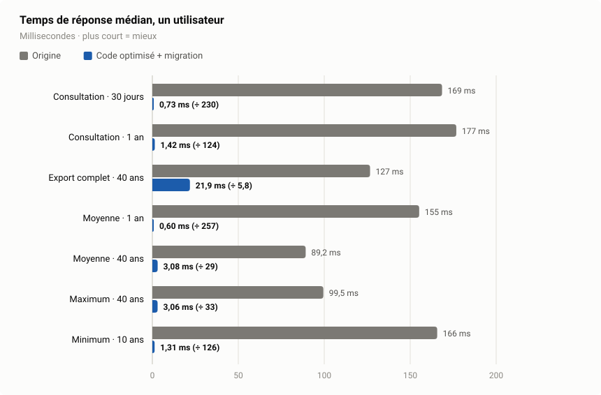

# WeatherTrack Pro — backend optimisé

Mini-projet 5PERF : audit de performance, optimisation et migration du backend de WeatherTrack Pro,
l'API qui stocke les relevés météorologiques historiques et en calcule les analyses (moyenne,
minimum, maximum de température).

Ce dépôt contient le code optimisé, l'outillage de mesure et les livrables du projet.

## Livrables

| Livrable | Où le trouver | Version PDF |
|---|---|---|
| 1. Rapport de performance | [docs/01-rapport-de-performance.md](docs/01-rapport-de-performance.md) | [PDF](docs/pdf/01-rapport-de-performance.pdf) |
| 2. Code optimisé et documentation des modifications | [`src/`](src), [docs/02-modifications-du-code.md](docs/02-modifications-du-code.md) | [PDF](docs/pdf/02-modifications-du-code.pdf) |
| 3. Document de recommandations | [docs/03-recommandations.md](docs/03-recommandations.md) | [PDF](docs/pdf/03-recommandations.pdf) |
| Mesures brutes et tableaux complets | [docs/benchmarks/](docs/benchmarks/README.md) | — |

Le code fourni au départ (l'archive de l'énoncé) est conservé tel quel dans le premier commit du
dépôt (`0a8852e`). Avec l'historique git, `git diff 0a8852e -- src` montre l'ensemble des
modifications ; sans lui, elles sont décrites une à une, extraits avant et après à l'appui, dans la
[documentation des modifications](docs/02-modifications-du-code.md).

## Résultats en bref

Mesures sur une base synthétique de 14,6 millions de relevés (1 006 lieux, 40 ans d'historique),
même machine et mêmes requêtes avant et après :

| Indicateur | Origine | Optimisé | Gain |
|:---|---:|---:|---:|
| Consulter un mois de mesures (médiane) | 169 ms | 0,73 ms | × 230 |
| Moyenne sur un an (médiane) | 155 ms | 0,60 ms | × 257 |
| Moyenne sur 40 ans (médiane) | 89 ms | 3,1 ms | × 29 |
| Exporter 40 ans, soit 14 610 mesures (médiane) | 127 ms | 22 ms | × 5,8 |
| Débit en trafic mixte, 20 utilisateurs | 8,5 req/s | 532 req/s | × 63 |
| Débit soutenu sans file d'attente | 5 req/s | 300 req/s | × 60 |



Les réponses de l'API sont inchangées : 1 104 requêtes comparées à l'application d'origine sans écart
inattendu, 47 tests automatisés.

## Installation

Prérequis : Node.js 20.10 (`nvm use`) et PostgreSQL 16.

```sh
docker run --name weather-db \
 -e POSTGRES_USER=WeatherTrack \
 -e POSTGRES_PASSWORD=mysecretpassword \
 -e POSTGRES_DB=WeatherTrack \
 -p 5432:5432 \
 -d \
 postgres:16-alpine
```

```sh
npm ci
```

## Utilisation

- En développement (TypeScript exécuté à la volée, schéma créé ou migré au démarrage) :

  ```sh
  npm run start:dev
  ```

- En mode surveillance et inspection :

  ```sh
  npm run start:watch
  ```

- En production (code compilé) :

  ```sh
  npm run build
  ```

  ```sh
  NODE_ENV=production npm run migrate
  ```

  ```sh
  NODE_ENV=production npm start
  ```

La configuration se règle par environnement dans `config/` (voir la documentation du paquet
[`config`](https://www.npmjs.com/package/config)) et peut être surchargée par la variable
`NODE_CONFIG`.

| Clé | Rôle | Défaut |
|---|---|---|
| `api.port` | Port d'écoute | 3000 |
| `api.compression` | Compression gzip/brotli des réponses de plus de 4 ko | `true` |
| `api.cacheMaxAgeSeconds` | Durée de l'en-tête `Cache-Control` des réponses `GET` (0 : désactivé) | 60 |
| `database.max` | Taille du pool de connexions PostgreSQL | 10 |
| `database.connectionTimeoutMillis` | Délai maximal d'obtention d'une connexion | 5000 |
| `database.statement_timeout` | Durée maximale d'une requête SQL (ms) | 15000 |
| `migrations.runOnStart` | Applique les migrations au démarrage | `true` (`false` en production) |

## Migrations de la base

Le schéma est géré par des migrations versionnées (`src/db/migrations.ts`), enregistrées dans la
table `schema_migrations`.

```sh
npm run migrate
```

| Migration | Effet |
|---|---|
| `001-create-weather-table` | Crée la table `weather` d'origine si elle n'existe pas (sans effet sur une base existante). |
| `002-covering-primary-key` | Remplace l'index de la clé primaire par un index couvrant `(location, date) INCLUDE (temperature, humidity)`, règle l'autovacuum de la table, puis lance `VACUUM ANALYZE`. |

La migration 002 s'exécute **en ligne** (`CREATE INDEX CONCURRENTLY`) : l'application reste
disponible en lecture comme en écriture, ce qui a été vérifié sous trafic. Comptez une vingtaine de
secondes pour 14,6 millions de lignes.
L'application fonctionne avant comme après la migration : celle-ci peut donc être appliquée
indépendamment du déploiement du code. Le détail et la procédure de retour arrière sont dans
[docs/02-modifications-du-code.md](docs/02-modifications-du-code.md).

## Description de l'API

Le contrat de l'API d'origine est inchangé. Les ajouts sont signalés par « nouveau ».

### Ingestion

Route interne, utilisée par les robots qui collectent les relevés.

- `POST` `/weather/data`

  ```json
  {
    "location": "Lyon",
    "date": "2023-12-24",
    "temperature": 25,
    "humidity": 40
  }
  ```

  Une seule mesure par lieu et par jour : un second envoi pour le même couple répond 500.

### Consultation

- `GET` `/weather/data/:location`

  Paramètres facultatifs :

  - `from` : date de début, **exclue** ;
  - `to` : date de fin, **incluse** ;
  - `limit` (nouveau) : nombre maximal de mesures renvoyées, de 1 à 100 000.

  ```sh
  curl "localhost:3000/weather/data/Lyon?from=2023-12-22&to=2023-12-25"
  ```

  ```json
  [
    {
      "location": "Lyon",
      "date": "2023-12-24T00:00:00.000Z",
      "temperature": 25,
      "humidity": 40
    },
    {
      "location": "Lyon",
      "date": "2023-12-25T00:00:00.000Z",
      "temperature": -3.2,
      "humidity": 90
    }
  ]
  ```

  Les mesures sont triées par date. La réponse est `null` pour un lieu inconnu et `[]` pour un lieu
  connu sans mesure sur la période. La date d'une mesure est restituée à minuit, heure locale du
  serveur.

  **Pagination (nouveau).** `from` étant exclu, la date de la dernière mesure reçue sert de curseur :

  ```sh
  curl "localhost:3000/weather/data/Lyon?limit=1000"
  ```

  ```sh
  curl "localhost:3000/weather/data/Lyon?limit=1000&from=1986-09-26T00:00:00.000Z"
  ```

### Analyses

- `GET` `/weather/avg/:location` — température moyenne : `{ "avg": 10.9 }`
- `GET` `/weather/max/:location` — température maximale : `{ "max": 25 }`
- `GET` `/weather/min/:location` — température minimale : `{ "min": -3.2 }`

Mêmes paramètres `from` et `to` que la consultation. La valeur est `null` pour un lieu inconnu ou une
période sans mesure (à l'origine, `/max` et `/min` répondaient 500 dans ce second cas).

```sh
curl "localhost:3000/weather/avg/Lyon?from=2023-12-22&to=2023-12-25"
```

## Tests

```sh
npm test
```

Tests unitaires, sans base de données (conversion des bornes de date, logique du service).

```sh
npm run test:integration
```

Tests d'intégration contre un PostgreSQL réel (configuration de `config/`, schéma dédié
`weathertrack_test` créé puis supprimé par les tests) : contrat de l'API relevé sur l'application
d'origine, migrations sur une base existante et sur une base vide.

## Mesurer les performances

L'outillage du dossier `bench/` a produit tous les chiffres du rapport ; il est réutilisable.

| Commande | Rôle |
|---|---|
| `node bench/seed.mjs --reset` | Génère le jeu de données de référence : 1 006 lieux, 40 ans, 14,6 millions de mesures (environ 2 minutes). |
| `node bench/run.mjs --label essai --out resultats.json` | Lance les suites de mesure contre un serveur démarré (latence, charge, scalabilité, écriture, paliers de débit). |
| `node bench/compare.mjs --reference URL --candidate URL` | Compare, réponse par réponse, deux versions de l'application (non-régression). |
| `node bench/profile-summary.mjs fichier.cpuprofile` | Résume un profil CPU V8 par famille de code. |
| `node bench/report.mjs` et `node bench/charts.mjs` | Produisent les tableaux et les graphiques du rapport à partir de `docs/benchmarks/`. |
| `node bench/cluster.mjs N` | Lance N processus de l'application derrière le même port (démonstration de mise à l'échelle). |

La procédure complète de reproduction est décrite en annexe du rapport de performance.

## Organisation du dépôt

```
src/
  index.ts              démarrage, migrations éventuelles, arrêt propre
  server.ts, app.ts     serveur Express, journal d'accès, compression
  weather/
    controller.ts       routes HTTP et validation
    service.ts          règles métier (périodes, contrat null / [])
    dayRange.ts         conversion des bornes from / to en jours
    repository.ts       requêtes SQL
    dto.ts              schémas de validation et types
  db/
    migrations.ts       migrations du schéma
    migrate.ts          exécuteur de migrations
tests/                  tests unitaires et d'intégration
bench/                  jeu de données, injecteur de charge, sondes, rapports
docs/                   livrables et mesures brutes
```
